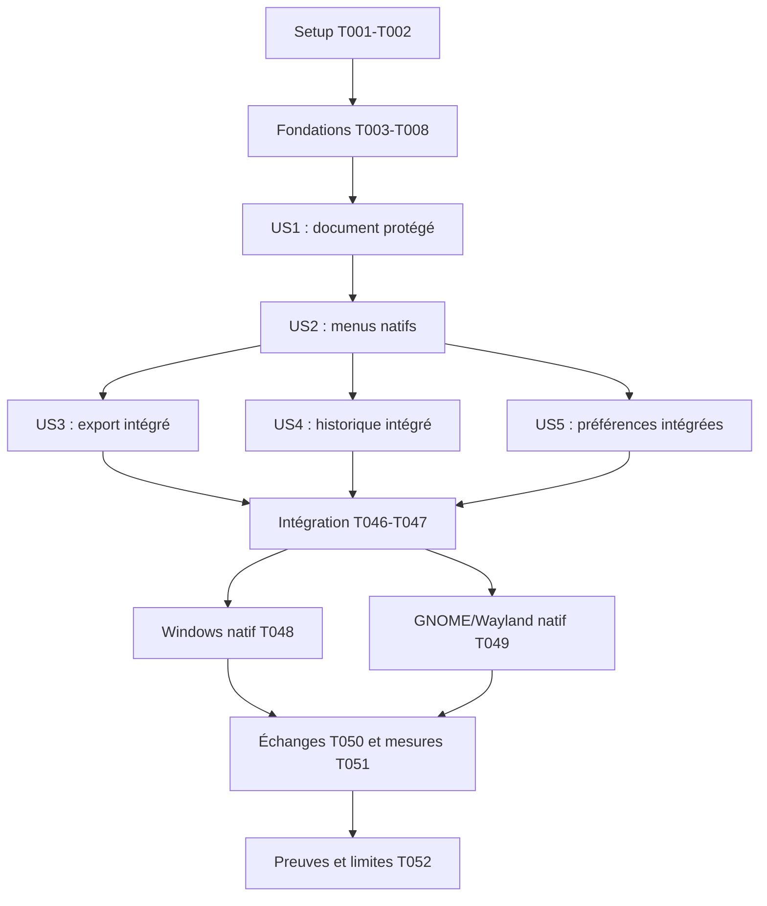

# Tasks: Menus et cycle de document Windows et Linux

**Input** : [spec.md](spec.md), [plan.md](plan.md), [research.md](research.md), [data-model.md](data-model.md), [contrat desktop](contracts/desktop-commands.md), [contrat des fichiers](contracts/note-format.md), [quickstart.md](quickstart.md).

**Branche** : `lmirguet-capgemini-menus-windows-natifs`.

**Prérequis** : conception des phases 0 et 1 terminée ; respecter `.specify\memory\constitution.md`. Ce fichier décrit du travail à faire : aucune case cochée ne peut être déduite des anciennes recettes du projet.

**Tests** : pas de démarche TDD supplémentaire imposée. Les scénarios et seuils SC-001 à SC-011 demandés par la spécification sont vérifiés après les incréments concernés. Les tâches de comportement incluent les régressions directement liées, dans les tests existants ou les deux harnais documentaires prévus au plan ; aucune suite ou infrastructure de tests sans rapport avec la fonctionnalité.

**Organisation** : une phase par user story, dans l'ordre P1 puis P2. Le domaine Rust reste canonique ; aucun nouveau fournisseur, appel LLM implicite, stockage d'audio ou accès filesystem générique du renderer.

## Format et conventions de chemins

Chaque tâche suit `- [ ] Tnnn [P?] [USn?] Description avec chemins`.

`[P]` autorise le travail parallèle uniquement lorsque ses prérequis sont terminés et les fichiers modifiés sont distincts. Sans `[P]`, suivre l'ordre indiqué. Les dépendances explicites et les barrières de phase priment sur la numérotation.

Tous les chemins de tâches sont relatifs à la racine du worktree, avec séparateurs Windows. Les commandes Linux équivalentes figurent dans le quickstart. Les nouveaux fichiers prévus sont indiqués comme tels ; ne pas créer un deuxième domaine ou renderer complet.

## Phase 1: Setup — dépendances et environnement

**But** : préparer le dépôt existant sans réinitialiser le projet.

- [X] T001 [P] Ajouter/verrouiller le plugin Rust `tauri-plugin-dialog` compatible Tauri 2 (version étudiée `2.8.4`) avec backend `gtk3` sans `xdg-portal`, la dépendance Linux `gtk = "=0.18.2"` avec `v3_24` et les seules features Win32 nécessaires dans `src-tauri\Cargo.toml` et `src-tauri\Cargo.lock` ; conserver les adaptateurs `keyring` existants et ne restaurer les dépendances qu'après modification du manifest.
- [X] T002 [P] Relever les prérequis disponibles et préciser ceux nécessaires aux futures recettes dans `specs\005-menus-windows-natifs\quickstart.md` : Windows 11/WebView2/NTFS, Fedora/GNOME/Wayland/GTK3/WebKitGTK sur Btrfs ou ext4, Rust `1.99.1`, Node `>=22.23.2 <23` ; un hôte absent reste à provisionner pour la recette, sans remplacer cette preuve par WSLg ou lancer micro/fournisseur.

**Checkpoint** : dépendances choisies et environnements requis identifiés ; aucun résultat natif encore présumé.

## Phase 2: Foundational — contrats et coordination partagés

**But** : établir les types, les gardes et les adaptateurs communs. Cette phase bloque les intégrations des cinq stories.

- [X] T003 Définir l'opération et ses transitions communes dans `src-tauri\src\app\document.rs` (nouveau), l'exposer dans `src-tauri\src\app\mod.rs` et intégrer son état au contrôleur dans `src-tauri\src\platform\controller.rs` : `workflow` vaut « Aucune opération ou référence de l'opération active. » ; `operationId` est un « Identifiant unique de cette demande, utilisé pour acquitter/annuler sans agir sur une autre demande. » et son `noteId` désigne le « Document d'origine de l'opération ; un changement inattendu invalide l'opération. » ; conserver exactement les valeurs `kind` « `new`, `open`, `save`, `save_as`, `export_markdown`, `quit`. », `phase` « `awaiting_ui`, `draining`, `choosing_file`, `confirming_save`, `confirming_overwrite`, `writing`, `committing`, `idle`. » et `outcome` « Terminé, annulé ou échec typé ; aucune annulation n'est présentée comme une réussite. » ; l'identifiant est créé par Rust, les demandes simultanées rejoignent l'opération active et aucune attente ne garde le verrou du cœur (après T001 et T002).
- [X] T004 Étendre ensemble `Snapshot` dans `src-tauri\src\domain\note.rs` et les DTO de `src\ui\contracts.ts` avec `documentName`, `documentPath`, `documentFormat`, `dirty`, disponibilités d'historique, opération et erreur selon le contrat desktop ; respecter `documentPath` « Chemin courant facultatif pour affichage local, sans autorité pour écrire. » et `documentFormat` « `von`, `markdown` ou null. » ; conserver les états vocaux et sérialiser les identifiants sans perte de précision JavaScript (après T003).
- [X] T005 [P] Créer le bridge injecté `src\ui\DocumentCommands.ts` : listener ciblé `document-command` enregistré avant activation, déduplication du dispatch, récupération de l'opération dans le snapshot si événement manqué et désabonnement ; préparer les variantes `ready`, `cancel`, `focus`, avec `uiAcknowledgement` « Révision et génération confirmant que les saisies déjà proposées ont été traitées sans divergence. » ; aucune réémission JS d'une intention native ni autorisation fondée sur un événement frontend (après T004).
- [X] T006 [P] Ajouter le répartiteur natif et ses interfaces de dialogue testables dans `src-tauri\src\platform\desktop.rs` (nouveau), l'exposer dans `src-tauri\src\platform\mod.rs` et relier les opérations de `src-tauri\src\app\document.rs` : événements ciblés `main` sans texte/clé/chemin, résultat `cancelled` distinct de l'échec, codes et messages français du contrat, gardes de note/version/modalité ; conserver les attentes de dialogue hors verrou et du travail bloquant hors thread UI (après T004).
- [X] T007 Enregistrer la nouvelle union IPC `document_action` avec `request`, `ready`, `cancel`, `focus`, `history`, `deny_unknown_fields` et vérification du label appelant dans `src-tauri\src\app\commands.rs`, `src-tauri\src\app\ipc_commands.rs`, `src-tauri\src\lib.rs`, `src-tauri\build.rs` et `src-tauri\capabilities\main.json` ; accorder seulement écoute/désabonnement et commandes nécessaires, sans capacité d'émission libre, shell ou filesystem ; les anciennes voies documentaires seront retirées lors de leur migration T020, pas laissées comme contournement final (après T006).
- [X] T008 Unifier la validation de `.von`/`.md` et des chemins dans `src-tauri\src\storage\markdown_file.rs`, `src-tauri\src\app\commands.rs` et `src-tauri\src\config\preferences.rs`, en réutilisant/extrayant un seul helper de validation ; reprendre les contraintes « Les chemins sont absolus, locaux, sans NUL ni traversal, limités comme les chemins actuels ; contrôler les destinations par identité native, pas par simple chaîne insensible à la casse. » et « Conserver les limites existantes : fichier sérialisé de 1 Mio au maximum, intention cumulée de 4096 octets, instructions de 16 384 octets. Vérifier aussi les limites après échappement de l'enveloppe, pas seulement la longueur du corps. » ; extensions sans casse, ajout du suffixe seulement s'il manque, erreur explicite sinon, sans fusionner les chemins Linux par minuscules (après T007).

**Checkpoint** : contrats communs compilables et adaptateurs injectables ; aucune story ne contournera les gardes ni ne dupliquera les accès de fichier.

## Phase 3: User Story 1 — Conserver son travail (P1, MVP)

**But** : nouvelle note, ouverture, sauvegarde explicite, Enregistrer sous et fermeture sans perte, sur les deux OS.

**Test indépendant** : depuis les commandes documentaires et la croix, créer contenu/contexte, sauvegarder et rouvrir ; exercer les quatre actions × trois décisions, les erreurs, le drainage annulable et les deux règles `.md`. Réaliser 20 cycles `.von` par OS, sans dépendre de l'export ni du nouvel historique.

### Implémentation

- [X] T009 [P] [US1] Remplacer l'autosauvegarde des mutations par une référence persistante dans `src-tauri\src\domain\note.rs` : `savedState` est « État persistant exact capturé par la dernière sauvegarde réussie, ou contenu/contexte vides et intention vide au départ. » ; `noteId` est une « Identité monotone de la note en mémoire ; change uniquement après Nouvelle note ou Ouvrir réussi. » et `revision` une « Révision monotone des changements persistants acceptés, y compris Annuler/Rétablir ; ne revient jamais à une ancienne valeur. » ; `instructions` reste « Texte temporaire, hors état sauvegardé et hors calcul de `dirty`. » ; calculer `dirty` par contenu/intention, y compris retour exact à l'état enregistré, et supprimer toute écriture à la frappe, dictée ou changement de contexte (après la phase 2).
- [X] T010 [P] [US1] Réutiliser et étendre les vérifications du codec dans `src-tauri\src\storage\note_document.rs` et `src-tauri\tests\prototype_envelope.rs` : `source` reste « Markdown UTF-8 exact de la note, indépendant de son rendu ProseMirror. » et `intention` conserve `purpose`, `form`, `tone`, `context` avec « Seul le contexte est éditable dans les nouveaux parcours ; préserver les autres champs historiques. » ; garder l'enveloppe `vocalnotes:intention:v1`, ses échappements et son garde de 32 768 octets de métadonnées JSON encodées, l'enveloppe vide anti-ambiguïté et les refus stricts ; aucun chemin, secret, instruction, historique ou normalisation LF/CRLF/Unicode (après la phase 2).
- [X] T011 [P] [US1] Extraire l'arrêt gracieux dans `src-tauri\src\platform\controller.rs` : arrêter la capture, drainer les segments et attendre un signal succès/échec de la reformulation déjà engagée au lieu du seul `AtomicBool`, sans appeler prématurément `stop(false)` ; conserver `inputGeneration` « Génération d'entrée des traitements existants ; protège aussi les instructions et les résultats de reformulation. » ; annulation/échec garde la note et les résultats acceptés, invalide les tickets restants, laisse le micro arrêté et n'émet aucune nouvelle requête (après la phase 2).
- [X] T012 [P] [US1] Définir le résultat et la préparation contrôlée communs dans `src-tauri\src\storage\markdown_file.rs` : `diskVersion` est la « Version du fichier associé validée à l'ouverture/écriture ; distincte des compteurs de note. » ; `WriteCandidate` contient « État persistant capturé, octets sérialisés, chemin demandé, format, version de note et version disque attendue. » ; `OverwriteConsent` signifie « Accord sur une destination et une version disque précise ; jamais un booléen global désactivant les vérifications futures. » ; `WriteResult` vaut « `saved`, `conflict` ou `failed`, avec versions et chemins de récupération si présents ; aucun résultat de copie n'est assimilé à `saved`. » ; préparation exclusive, versions récupérables et aucun rollback sur un autre écrivain (après la phase 2).
- [X] T013 [P] [US1] Adapter la branche Linux dans `src-tauri\src\storage\markdown_file.rs` : conserver `openat`/`O_NOFOLLOW`, volume local, identité `(dev, ino)`, permissions/ACL/liens, `RENAME_EXCHANGE`, synchronisation et vérifications ; ajouter `RENAME_NOREPLACE` pour installer une préparation sans écrasement ; primitive/métadonnées non prises en charge donnent une erreur récupérable et non l'adoption de `Copy`, avec relecture avant écriture indépendamment du watcher (après T012).
- [X] T014 [P] [US1] Implémenter les primitives Windows dans `src-tauri\src\storage\windows_file.rs` (nouveau) selon le contrat T012 : identité fichier/volume par handle, contrôle du répertoire, points de réanalyse/liens, préparation synchronisée, `ReplaceFileW` avec version déplacée et ACL conservées, installation absente sans écrasement, erreurs partielles et contrôles après écriture ; pas d'identité factice, de troncature, suppression/renommage ou garantie fondée sur `REPLACEFILE_WRITE_THROUGH` (après T012).
- [X] T015 [US1] Intégrer les deux branches dans `src-tauri\src\storage\mod.rs` et `src-tauri\src\storage\markdown_file.rs`, et adapter les régressions directement affectées de `src-tauri\tests\storage_integrity.rs` : `DiskVersion` est « Empreinte SHA-256 des octets, identité native obtenue par handle Windows ou `(dev, ino)` sous Linux, caractéristiques nécessaires au contrôle de liens et de permissions. Recalculée à l'ouverture locale, jamais persistée dans `.von`. » ; couvrir créations concurrentes, changements avant/après remplacement, interruptions, droits et récupérations, sans considérer un test ignoré par `cfg` comme un succès (après T013 et T014).
- [X] T016 [P] [US1] Implémenter les sélecteurs natifs et les confirmations asynchrones (plugin Windows ; dialogues GTK3 directs sur le thread GTK sous Linux, car `rfd 0.17.2` ignore leur parent) dans `src-tauri\src\platform\desktop.rs` : parent `main`, filtres `.von`/`.md`, choix Enregistrer/Ne pas enregistrer/Annuler, remplacement visant la version observée ; mapper explicitement résultats typés et `Custom`, traiter Echap/croix/Cancel comme annulation et une réponse inconnue ou un chemin non local comme erreur visible, sans API bloquante sur le thread UI (après la phase 2).
- [X] T017 [US1] Implémenter Enregistrer/Enregistrer sous dans `src-tauri\src\app\document.rs` et `src-tauri\src\domain\note.rs`, avec les cas pertinents de `src-tauri\tests\document_workflow.rs` (nouveau) et `src-tauri\tests\prototype_ordered_save.rs` : `destination` est un « Chemin absolu local éventuellement associé ; change seulement après ouverture ou sauvegarde complète réussie. Jamais sérialisé dans le fichier de note ni interprété sur l'autre système. » ; `format` vaut « `von`, `markdown` ou absence de format sans destination ; déterminé par le chemin sélectionné, extension insensible à la casse. » ; `openedContext` est le « Contexte chargé à l'ouverture du fichier courant, pour la règle de migration des `.md` ; remis à jour lors de l'adoption d'une nouvelle destination. » ; `.md` sans changement de contexte reste au même chemin, contexte ajouté/modifié/vidé impose `.von` et laisse le `.md` initial intact ; capturer l'état accepté sans arrêter la dictée/attendre le réseau et ne marquer sauvegardé que l'état réellement écrit (après T009, T010, T015 et T016).
- [X] T018 [US1] Implémenter Nouvelle note/Ouvrir/Quitter dans `src-tauri\src\app\document.rs` et `src-tauri\src\app\close.rs`, avec les cas de `src-tauri\tests\document_workflow.rs` et `src-tauri\tests\close_workflow.rs` : préparation UI, drainage, décision à trois issues, sauvegarde réussie avant poursuite et publication atomique du candidat ; `candidate` reste un « Candidat de lecture ou d'écriture, gardé séparé de la note active tant que non validé. » ; un fichier invalide après Ne pas enregistrer garde la note en mémoire, une note propre ne demande pas de sauvegarde et aucun résultat tardif ne rejoint une autre note (après T011 et T017).
- [X] T019 [US1] Brancher la préparation réelle des propositions et champs différés dans `src\ui\DocumentCommands.ts` et `src\ui\DesktopShell.ts` : gel des nouvelles éditions, vidage et acquittement des files avant `ready`, nouvelle réconciliation si révision/génération a changé, refus de `ready` si texte récupérable non résolu ; afficher attente annulable et diagnostics tout en recevant les états canoniques, puis libérer l'UI selon l'issue réelle (après T018).
- [X] T020 [US1] Raccorder croix/Alt+F4 de `main`, commandes existantes et titre natif au coordinateur dans `src-tauri\src\lib.rs`, `src-tauri\src\app\commands.rs`, `src-tauri\src\app\ipc_commands.rs` et `src\ui\DesktopShell.ts` : prévenir la fermeture initiale et détruire seulement après validation hors verrou, afficher nom/« Sans titre » et modification, retirer ou migrer New/Open/SaveCopy/Save de `prototype_action` et `prototype_finish_close`, supprimer la saisie libre de destination et vider l'historique de l'ancienne note ; ne pas appliquer la fermeture documentaire aux autres fenêtres (après T019).

### Validation de l'incrément

- [X] T021 [US1] Exécuter et corriger les régressions liées à SC-002, SC-009 et SC-010 dans `src-tauri\tests\document_workflow.rs`, `src-tauri\tests\close_workflow.rs`, `src-tauri\tests\prototype_ordered_save.rs` et `src\ui\DesktopShell.test.ts` : quatre actions × trois décisions, note propre/contexte seul, annulations, erreurs, saisie refusée, capture/LLM en cours, double demande et résultat périmé ; aucune écriture à l'édition ni perte après annulation/échec (après T020).
- [ ] T022 [US1] Réaliser les 20 cycles `.von` par OS et les parcours `.md` de SC-003/SC-010 selon `specs\005-menus-windows-natifs\quickstart.md`, après les contrôles de stockage natifs de `src-tauri\tests\storage_integrity.rs` ; comparer contenu/contexte exacts et lisibilité hors application, consigner les preuves de l'incrément ou le blocage d'hôte sans certifier les menus/préférences non encore intégrés (après T021).

**Checkpoint** : MVP documentaire protégé. Les premiers accès peuvent encore être les commandes existantes migrées ; la barre native relève d'US2 et la fonctionnalité complète n'est pas livrable à ce seul stade.

## Phase 4: User Story 2 — Interaction de menus native (P1)

**But** : une seule barre système, commandes dans l'ordre demandé, raccourcis uniques et navigation accessible.

**Test indépendant** : vérifier structure et dispatch avec un adaptateur injecté, puis parcourir Fichier/Edition/Aide à la souris et au clavier ; une activation doit produire une seule intention et rendre le focus. Les effets export/historique/préférences sont intégrés dans leurs stories ; leur recette complète suit en phase 8.

### Implémentation et vérification

- [X] T023 [P] [US2] Construire les trois menus, dix identifiants/libellés, sept raccourcis et mnémoniques exacts du contrat dans `src-tauri\src\platform\desktop.rs`, avec `Menu`, `Submenu` et items ordinaires, sur `main` seulement ; même surface Windows/GTK, pas de menu global GNOME requis ni d'items undo/redo prédéfinis indisponibles (après T020).
- [X] T024 [P] [US2] Retirer la barre HTML et ses panneaux de chemin de `src\ui\DesktopShell.ts`, `src\ui\MenuBar.ts` et `src\style.css`, en conservant uniquement l'adaptateur injecté nécessaire aux tests de montage ; supprimer les accélérateurs DOM documentaires concurrents sans casser les raccourcis locaux du formulaire de préférences (après T020).
- [X] T025 [US2] Relier les événements de menu aux intentions uniques dans `src-tauri\src\lib.rs`, `src-tauri\src\platform\desktop.rs` et `src-tauri\src\app\document.rs` : filtrer identifiant/fenêtre active/modalité, fusionner `file.quit` et CloseRequested, ne pas renvoyer un second `request` JS et garder les points de branchement export/historique/préférences du contrat pour leurs stories respectives (après T023 et T024).
- [X] T026 [US2] Synchroniser dernière zone active, disponibilité grisée et restitution de sélection/focus dans `src\ui\DocumentCommands.ts`, `src\ui\NoteView.ts` et `src-tauri\src\platform\desktop.rs` ; les états viennent du domaine et de l'opération, pas d'un focus passé au titre du menu ; exposer noms accessibles et raccourcis, avec retour depuis Echap/clic extérieur sans action (après T025).
- [X] T027 [US2] Vérifier structure, absence de deuxième barre, déduplication, désabonnement et cible de focus via les cas de `src\ui\DesktopShell.test.ts` et les tests de l'adaptateur dans `src-tauri\src\platform\desktop.rs` ; préparer le parcours natif Alt/F10/flèches/Entrée/Echap/survol de SC-001 dans `specs\005-menus-windows-natifs\quickstart.md`, dont la validation des dix effets définitifs attend la phase 8 (après T026).

**Checkpoint** : la barre native remplace l'ancienne UI et son dispatch est vérifiable sans confondre doubles et preuve de fonctionnement natif complet.

## Phase 5: User Story 3 — Exporter le seul contenu Markdown (P2)

**But** : produire une copie `.md` du contenu accepté courant sans contexte ni changement de document de travail.

**Test indépendant** : distinguer corps/contexte/instructions, modifier sans sauvegarder, exporter puis comparer les octets au corps et vérifier chemin/dirty inchangés ; 20 exports par OS.

### Implémentation et vérification

- [X] T028 [P] [US3] Ajouter la branche `export_markdown` dans `src-tauri\src\app\document.rs` et ses cas dans `src-tauri\tests\document_workflow.rs` : écrire exactement les octets UTF-8 de `source` capturé, même vide ou non sauvegardé, sans encodeur d'enveloppe ni suppression de texte ressemblant au contexte ; conserver `savedState`, `diskVersion`, destination, format, dirty et historique, sans arrêter la capture ni attendre le réseau (après T017 et T018).
- [X] T029 [P] [US3] Ajouter le refus de destination représentant le document courant et le contrôle de remplacement d'un autre fichier dans `src-tauri\src\storage\markdown_file.rs` et `src-tauri\tests\storage_integrity.rs` : identité native, alias/liens et casse selon le système, version observée puis recontrôlée, annulation et erreur non destructives ; ne pas confondre deux fichiers Linux dont seuls les noms diffèrent par la casse (après T015).
- [X] T030 [US3] Raccorder `file.export_markdown` et son sélecteur `.md` dans `src-tauri\src\platform\desktop.rs` au coordinateur, avec ajout du suffixe absent, remplacement confirmé et diagnostic visible ; n'adopter aucun chemin d'export et réactiver l'éditeur après annulation/erreur (après T025, T028 et T029).
- [X] T031 [US3] Vérifier les 20 exports par OS de SC-004 dans `src-tauri\tests\document_workflow.rs` et `specs\005-menus-windows-natifs\quickstart.md` : vide, note sans chemin, contenu non sauvegardé, refus/échec, alias courant et contexte identique à du texte saisi dans le corps ; comparer octets et invariants, sans considérer les seuls tests simulés comme la recette desktop finale (après T030).

**Checkpoint** : export utilisable seul ; la note complète et ses protections restent inchangées.

## Phase 6: User Story 4 — Annuler et rétablir par zone (P2)

**But** : historique canonique Rust de Contenu/Contexte/Instructions, quelle que soit l'origine de la modification.

**Test indépendant** : 20 séquences par OS sur les trois zones et les sources manual/formatting/dictation/reformat ; une reformulation est une entrée, les autres zones restent intactes et revenir à la sauvegarde retire dirty.

### Implémentation et vérification

- [X] T032 [P] [US4] Créer `src-tauri\src\domain\history.rs` et l'exposer dans `src-tauri\src\domain\mod.rs` : `history` signifie « Historiques en mémoire des trois zones, liés à ce `noteId`. » ; `area` suit « Identité et portée : `content`, `context` ou `instructions`. » et `origin` « `manual`, `formatting`, `dictation`, `reformat` ; information en mémoire seulement. » ; conserver « Capacité globale : 256 entrées et 16 Mio de deltas. » avec éviction cohérente et indication utilisateur, sans troncature de texte (après la phase 2).
- [X] T033 [US4] Alimenter les piles depuis toutes les mutations acceptées dans `src-tauri\src\domain\note.rs` et `src-tauri\src\platform\controller.rs`, avec les cas de `src-tauri\tests\document_history.rs` (nouveau) : `before`, `after` sont des « Deltas réversibles avec texte attendu, sur frontières UTF-8 valides ; contexte et instructions peuvent utiliser un remplacement de champ complet. » ; segment finalisé et reformulation réussie groupés, redo invalidé seulement dans la zone modifiée, nouvelle note/ouverture vident tout, sortie d'Instructions efface valeur et pile, sauvegarde/export préservent les piles (après T009, T011, T018 et T032).
- [X] T034 [US4] Implémenter `history` undo/redo dans `src-tauri\src\app\document.rs` et `src-tauri\src\app\commands.rs`, en vérifiant noteId/révision/génération/texte attendu et `transactionId` selon « Déduplication d'une proposition réessayée ou regroupement d'un segment finalisé. » ; garder les révisions monotones, recalculer dirty et disponibilités par zone, refuser les versions périmées explicitement et ne faire ni écriture disque ni appel fournisseur (après T033).
- [X] T035 [P] [US4] Remplacer les piles manuelles autonomes et neutraliser l'undo DOM/ProseMirror concurrent dans `src\ui\DesktopShell.ts`, `src\ui\DocumentCommands.ts` et `src\ui\NoteView.ts`, avec les cas de `src\ui\Prototype.editor.test.ts` : utiliser les requêtes d'historique typées et la dernière zone active, préserver sélection/blocs opaques/réconciliation, et garder l'édition des champs de préférences locale à leur fenêtre (après T026).
- [X] T036 [US4] Exécuter les 20 séquences SC-005 sur les deux OS à partir de `src-tauri\tests\document_history.rs`, `src\ui\Prototype.editor.test.ts` et `specs\005-menus-windows-natifs\quickstart.md`, dont dictée, reformulation en une entrée, branche redo abandonnée, retour au savedState, sauvegarde et éviction ; les interactions complètes avec l'export sont rejouées après intégration de toutes les stories en T047 (après T034 et T035).

**Checkpoint** : une autorité unique d'historique couvre les trois zones et leurs sources de modification.

## Phase 7: User Story 5 — Préférences et A propos familiers (P2)

**But** : une fenêtre de préférences unique, réellement modale sur chaque OS, brouillon OK/Annuler et A propos sans toucher à la note.

**Test indépendant** : ouvrir, modifier, annuler puis confirmer et rouvrir ; vérifier dix parcours sans doublon et la libération du propriétaire après chaque fermeture/échec, avec contrôle du clavier et du focus dans les bureaux réels.

### Implémentation et vérification

- [X] T037 [P] [US5] Réutiliser la validation des modèles et rendre leur persistance transactionnelle dans `src-tauri\src\config\preferences.rs` et `src-tauri\src\app\commands.rs` : `PreferencesStore` est le « Magasin existant de modèles STT/LLM et dernière destination locale ; jamais de secret. Les clés restent dans le trousseau natif, Windows Credential Manager ou Secret Service Linux. » ; OK ne publie les nouveaux modèles qu'après validation/écriture réussie, conserve les règles existantes de prise d'effet, ne contacte aucun fournisseur et garde l'ancien état en cas d'échec (après la phase 2).
- [X] T038 [P] [US5] Adapter le formulaire de `src\ui\ModelPreferencesView.ts` avec les régressions de `src\ui\ModelPreferencesView.test.ts` : `PreferencesDraft` est une « Copie locale des modèles à l'ouverture ; modifications temporaires jusqu'à OK. » ; OK attend la persistance, Annuler/Echap/croix abandonnent le brouillon, une erreur le garde visible ; distinguer les actions de trousseau explicitement immédiates, ne relire aucune clé et effacer toute clé seulement saisie lors de la fermeture (après la phase 2).
- [X] T039 [US5] Créer le cycle de fenêtre dans `src-tauri\src\platform\desktop.rs` et `src-tauri\src\app\document.rs` : `PreferencesWindow` suit « Label fixe `preferences`, propriétaire `main`, cadre système, unique, sans menu de note. » ; construire caché depuis un contexte asynchrone, préparer la modalité avant affichage et focaliser l'instance existante ; `ModalGuard` garde un « État de modalité attaché à l'instance réelle : propriétaire désactivé par Win32 ou fenêtre GTK transitoire/modale. Nettoyage idempotent sur fermeture, destruction du propriétaire ou échec. Aucun objet GTK transféré hors du thread principal. » ; bloquer aussi les commandes documentaires côté Rust (après T016, T020, T025, T037 et T038).
- [X] T040 [US5] Implémenter la branche Windows du garde dans `src-tauri\src\platform\desktop.rs` : propriétaire natif et `EnableWindow` sur le thread de fenêtre, état effectif vérifié sans prendre sa valeur de retour pour un code de succès ; réactiver main avant destruction et sur toutes les erreurs, garder cadre système et absence de menu documentaire (après T039).
- [X] T041 [US5] Implémenter la branche Linux du garde dans `src-tauri\src\platform\desktop.rs` : `gtk_window()` puis `GtkWindowExt::set_transient_for`, `set_modal(true)` et `set_destroy_with_parent(true)` via `run_on_main_thread`, libération et focus de main à la fermeture ; fermer explicitement le dialogue avec son propriétaire et nettoyer l'état Tauri, sans objet GTK déplacé entre threads, solution CSS seule ou dépendance X11/position absolue (après T040).
- [X] T042 [P] [US5] Exposer `preferences_open` à main et `preferences_close` au seul dialogue, restreindre écriture des modèles et opérations de trousseau à preferences, garder la lecture utile et vérifier labels/arguments dans `src-tauri\src\app\commands.rs`, `src-tauri\src\app\ipc_commands.rs`, `src-tauri\src\lib.rs`, `src-tauri\build.rs`, `src-tauri\capabilities\main.json` et `src-tauri\capabilities\preferences.json` (nouveau) ; refuser mutation de note, navigation distante et pouvoirs génériques, et distinguer croix du dialogue et fermeture documentaire (après T037 et T041).
- [X] T043 [P] [US5] Monter le formulaire selon le label réel de fenêtre dans `src\main.ts`, retirer les préférences inline de `src\ui\DesktopShell.ts` et adapter `src\style.css` : page locale seulement, pas de deuxième shell documentaire ni privilège par query string ; titre « Préférences », thème/typographie/contrôles familiers du système, focus visible, Tab/Maj+Tab confinés, OK/Annuler sans bouton Appliquer et aucun faux cadre Windows sous GNOME (après T038 et T041).
- [X] T044 [US5] Raccorder A propos et achever les fermetures OK/Annuler/Echap/croix/destruction dans `src-tauri\src\platform\desktop.rs` et `src-tauri\src\lib.rs` : nom/version issus de `app.package_info()`, dialogue système sans troisième webview ; fermeture uniquement après persistance réussie pour OK, nettoyage idempotent et restitution de la dernière zone de main, sans toucher à la note ou redémarrer l'écoute (après T042 et T043).
- [X] T045 [US5] Vérifier dix parcours SC-006 et les frontières de fenêtre avec `src\ui\ModelPreferencesView.test.ts`, `src\ui\Startup.test.ts`, `src-tauri\tests\document_workflow.rs` et `src-tauri\tests\ipc_boundary.rs` : brouillon annulé/confirmé, erreurs de persistance/création, demande répétée, destruction, commandes de note refusées et clé non divulguée ; les assertions simulées ne certifient pas le focus natif exigé en T048/T049 (après T044).

**Checkpoint** : les cinq stories sont intégrées ; les recettes natives, échanges et mesures de sortie restent obligatoires.

## Phase 8: Polish — intégration et preuves transversales

**But** : vérifier la fonctionnalité entière, sans prendre les succès partiels ou historiques pour une livraison conforme.

- [X] T046 Mettre à jour les messages d'aide/notices de `src\ui\DesktopShell.ts` et les instructions courantes de `specs\005-menus-windows-natifs\quickstart.md` pour sauvegarde explicite, `.von`/`.md`, export, menus et préférences ; supprimer les annonces d'autosauvegarde encore actives sans réécrire les rapports historiques de `docs\validation\storage-gnome.md` ou `docs\validation\foundations-gnome.md` (après T027, T031, T036 et T045).
- [ ] T047 Exécuter les sélecteurs ciblés et builds de `specs\005-menus-windows-natifs\quickstart.md` sur chaque hôte avec `package.json` et `src-tauri\Cargo.toml` verrouillés ; contrôler `src-tauri\tests\document_workflow.rs`, `src-tauri\tests\document_history.rs`, stockage, fermeture, drafting, enveloppe, IPC et frontend, y compris export conservant l'historique et absence d'autosave ; inspecter features GTK3/sans portail et doublons GTK, puis élargir seulement si l'impact l'exige (après T046).
- [ ] T048 Exécuter la recette native complète Windows 11/WebView2/NTFS de `specs\005-menus-windows-natifs\quickstart.md` sur le binaire identifié, notamment les dix commandes/sept raccourcis SC-001, quatre actions/trois décisions, dix parcours de préférences, clavier/focus, doubles événements, remplacement Win32 et récupération ; conserver les résultats propres à cet hôte pour T052, sans micro/API ni modification de note réelle (après T047).
- [ ] T049 Exécuter séparément la recette native Fedora/GNOME/Wayland/WebKitGTK de `specs\005-menus-windows-natifs\quickstart.md`, notamment F10/mnémoniques depuis chaque zone, parentage GTK des dialogues, trois décisions, dix parcours de préférences et modalité/focus après erreur/destruction, échange Linux et refus de métadonnées ; identifier session, volume et binaire, sans extrapoler depuis Windows ni remplacer par WSLg/XWayland, et conserver les résultats pour T052 (après T047).
- [ ] T050 Réaliser SC-011 et l'aller-retour de `.md` selon `specs\005-menus-windows-natifs\contracts\note-format.md` et `specs\005-menus-windows-natifs\quickstart.md` : 20 échanges Windows vers Linux et 20 Linux vers Windows, réouverture/réenregistrement et comparaison de source/quatre chaînes d'intention/export brut, sans filtre de fins de ligne ni identité/chemin du système d'origine ; utiliser exclusivement les fichiers synthétiques prévus (après T048 et T049).
- [ ] T051 Mesurer SC-007 et faire réaliser SC-008 selon `specs\005-menus-windows-natifs\quickstart.md` sur chaque système : 30 essais avec au moins 29 réponses visibles sous 300 ms, puis au moins 4 utilisateurs sur 5 familiers du système réussissant les parcours sans aide et identifiant la familiarité des préférences ; consigner conditions et résultats séparés, sans fabriquer de participants ou remplacer l'interaction réelle par le temps d'un handler (après T048 et T049).
- [ ] T052 Reporter les preuves et limites réelles de T022/T031/T036/T045/T047 à T051 dans une section de résultats datés de `specs\005-menus-windows-natifs\quickstart.md`, distinguer tests automatisés, stockage natif, recette, échanges et utilisateurs, puis vérifier le diff final ; un hôte, une recette, une mesure ou des participants manquants laissent les tâches concernées non cochées et la livraison non validée, sans annonce globale de réussite (après T022, T050 et T051).

Le bilan provisoire de T052 peut être renseigné dès qu'un résultat ou un blocage est observé, sans attendre la réussite de ses prérequis. Ses dépendances conditionnent sa clôture et la validation finale, pas la consignation des limites ; une tâche bloquée ne devient pas terminée pour permettre ce bilan.

**Checkpoint final** : toutes les exigences FR-001 à FR-020 et tous les critères SC-001 à SC-011 ont une preuve correspondant à leur plateforme ou un blocage explicitement non validé.

## Dependencies & Execution Order

### Barrières et dépendances des stories

La phase 2 suit T001/T002 et doit être terminée avant les intégrations des stories. Les mentions « après la phase 2 » visent T003 à T008 terminées, y compris le bridge T005. Les autres prérequis de tâche sont indiqués directement sur chaque ligne.

| Story | Préparation et dépendances | Fin vérifiable |
|-------|-----------------------------|----------------|
| US1 | Phase 2 ; noyaux domaine, codec, drainage et stockage séparables. | T021 vérifie le flux ; T022 ajoute les cycles de fichiers natifs. |
| US2 | Intégration documentaire T020 ; ne dépend pas de la recette T022 pour construire le menu. | T027 vérifie menu/dispatch ; effets complets et navigation native finale en T048/T049. |
| US3 | Noyau après T015/T017/T018 ; raccordement au menu après T025. | T031 vérifie l'export indépendamment du nouveau moteur d'historique. |
| US4 | Moteur isolé après phase 2 ; mutations après US1 ; bridge après T026. | T036 vérifie l'historique ; conservation par l'export recontrôlée en T047. |
| US5 | Magasin et formulaire après phase 2 ; fenêtre après T020/T025 ; deux branches natives et permissions avant intégration finale. | T045 vérifie le protocole ; modalité/focus natifs en T048/T049. |
| Transverse | T027/T031/T036/T045, puis contrôles intégrés et deux recettes. | T050/T051 puis synthèse T052 ; T022 reste nécessaire au bilan. |

Le graphe représente l'ordre d'intégration/livraison, pas une interdiction de préparer plus tôt les noyaux `[P]`. Aucune story P2 ne bloque le MVP documentaire. T022 n'est pas remplacée par une simple compilation et reste non cochée si le second hôte n'est pas accessible.

### Ordre interne

Stabiliser les types avant leurs implémentations ; terminer le stockage avant le commit d'une sauvegarde ; terminer préparation UI et drainage avant l'action destructive ; ne publier les nouvelles permissions de préférences qu'avec les contrôles de label correspondants. Mettre à jour les régressions directement touchées avec le comportement, puis exécuter les validations de l'incrément.

Deux tâches qui touchent un même fichier ne sont pas exécutées simultanément, même si leurs stories diffèrent. Les recettes T048/T049 sont indépendantes sur leurs hôtes, mais leur synthèse commune dans le quickstart est réservée à T052. Pas de partage d'un dossier de fixtures entre processus concurrents.

## Parallel Examples — une possibilité par story

| Story | Exemple exécutable après les prérequis indiqués | Séparation |
|-------|-----------------------------------------------|------------|
| US1 | Après phase 2 : T009 avec T010, T011, T012 et T016 ; après T012 : T013 avec T014. | Domaine, codec, contrôleur, stockage et desktop distincts ; branches Linux/Windows écrites dans des fichiers distincts. |
| US2 | Après T020 : T023 avec T024. | Menu Rust versus retrait HTML/CSS ; intégrer ensemble en T025. |
| US3 | Après T015/T017/T018 : T028 avec T029. | Coordinateur et cas documentaires versus stockage et cas d'intégrité ; assembler en T030. |
| US4 | Après T026 et phase 2 : T032 avec T035. | Moteur Rust isolé versus bridge/éditeur TypeScript sur contrat déjà fixé ; terminer T033/T034 avant T036. |
| US5 | Après phase 2 : T037 avec T038 ; après T041 : T042 avec T043. | Magasin Rust versus formulaire ; puis permissions natives versus montage frontend. Ne pas paralléliser T040/T041, qui modifient le même fichier. |

Ces exemples n'autorisent pas d'autres tâches simultanées qui modifieraient les mêmes fichiers. Le parallélisme reste une possibilité de découpage, pas une demande de lancement automatique d'agents.

## Couverture exigences et validations

| Exigences | Tâches principales | Critères et preuves |
|-----------|---------------------|---------------------|
| FR-001, FR-002, FR-003 | T023 à T027 | SC-001, recettes natives T048/T049. |
| FR-004, FR-005, FR-007, FR-009 | T008, T012 à T022 | SC-002 et refus/erreurs natifs. |
| FR-006 | T010, T015, T017, T022 | SC-003 ; lisibilité du fichier et fidélité corps/contexte. |
| FR-008 | T004, T009, T017, T020, T033/T034 | Retour à la sauvegarde et édition après capture d'écriture. |
| FR-010, FR-011 | T012 à T015, T028 à T031 | SC-004 ; alias courant et version externe protégés. |
| FR-012, FR-013 | T026, T032 à T036 | SC-005 ; zones, origines, piles et compteurs. |
| FR-014, FR-015, FR-016 | T037 à T045 | SC-006 ; modalité/focus et A propos natifs T048/T049. |
| FR-017 | T003 à T007, T011, T018 à T021 | SC-009 ; file UI, drainage et déduplication. |
| FR-018 | T008, T010, T017, T021/T022 | SC-010 ; `.md` conservé ou migration explicite non destructive. |
| FR-019 | Toutes les stories, T047 à T049 | SC-001 à SC-010 séparément par OS ; SC-007/SC-008 en T051. |
| FR-020 | T010, T015, T022, T050 | SC-011 ; 20 échanges par sens et aucune conversion silencieuse. |

## Implementation Strategy

### MVP d'abord — US1

Terminer Setup/fondations, puis T009 à T022. Démontrer les commandes documentaires migrées et la fermeture protégée avec sauvegarde `.von` et compatibilité `.md`. Ce MVP ne prétend pas résoudre toute la demande de menus, d'export, d'historique ou de préférences.

### Livraison incrémentale

Intégrer US2 après le flux sûr, puis US3/US4/US5 en conservant les contrats communs. Chaque story possède son critère indépendant ci-dessus ; les intégrations utilisent les mêmes garde-fous, pas une implémentation parallèle contournant le coordinateur. Ne pas désactiver une commande sur Linux au seul motif qu'elle avait été conçue d'abord pour Windows.

### Validation et clôture

Passer ensuite la phase 8 sur les deux environnements réels et mesurer les seuils prescrits. Si les hôtes ou utilisateurs nécessaires sont indisponibles, terminer uniquement le travail effectivement vérifié, garder les recettes en attente et signaler le blocage ; ne pas cocher artificiellement les tâches ni déclarer la fonctionnalité livrée.

## Notes

L'exécution se fait dans le worktree et la branche existants. Aucun commit, PR, lancement de fournisseur ou accès à des notes réelles n'est demandé par la génération de cette liste. Les fichiers de récupération utiles sont conservés ; seuls les fichiers transitoires synthétiques identifiés peuvent être nettoyés après vérification.
